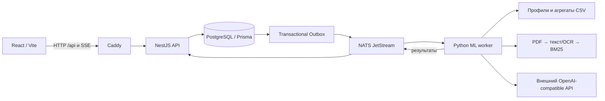

# Corpo News

Персональная новостная аналитика для бизнеса: профиль компании, отбор экономических новостей по влиянию на её деятельность, объяснение причин и чат по выбранной новости.

## Архитектура и компоненты



Frontend использует React Query, опрашивает профиль/ленту и восстанавливает историю чата после переподключения. Backend хранит данные, проверяет DTO, публикует события через транзакционный outbox и раздаёт SSE. Worker обогащает профиль, оценивает релевантность и отвечает в чате. HTTP API у worker отсутствует. Контракты NATS находятся в `corpo-news/contract/` и `ml-service/contract/`; их меняют совместно.

Профиль банка из CSV и выводы модели разделены в интерфейсе. Блок позиции банка заполняется извлечёнными фрагментами PDF с документом и страницей; рекомендации модели отображаются отдельно. BM25 — поиск по тексту, без embedding API или векторной БД.

## Требования

- Docker Engine и Docker Compose **2.24.4+** (демо override использует `!override`); проверка: `docker version` и `docker compose version`.
- Linux amd64 — проверенная платформа. Доступ к `git.birlab.ru`, Docker Hub, npm и PyPI при первой сборке.
- Рекомендуемый резерв для локальной проверки: 4 CPU, 8 ГБ RAM и 10 ГБ диска. Это ориентир, не результат нагрузочного теста.
- Для стандартного Docker-запуска Node/Python на хосте не нужны. Backend/frontend собираются на Node 22.23.1 по digest; worker — Python 3.12. Зависимости фиксируются двумя `pnpm-lock.yaml` и `ml-service/requirements.lock`.

## Один запуск для проверки без ключей и закрытых данных

Из корня каталога с исходниками **и локальным комплектом `demo/`**:

```bash
bash demo/start.sh
```

Команда создаёт отдельный Compose project `corpo-news-jury`, собирает пять сервисов, ждёт healthcheck/migrations и добавляет две синтетические новости. Worker работает в `LLM_MODE=stub`, RAG и автоматический RSS отключены. Ключ API не нужен; этот режим проверяет взаимодействие компонентов, но не качество генеративной модели и не OCR.

| Адрес | Назначение |
| --- | --- |
| http://127.0.0.1:28082 | Интерфейс |
| http://127.0.0.1:28082/api/swagger | Swagger UI через web proxy |
| http://127.0.0.1:28082/api/swagger-json | OpenAPI JSON |
| http://127.0.0.1:23001/swagger | Swagger напрямую у backend; выбрать сервер `/` |
| 127.0.0.1:25432 | PostgreSQL, пользователь/пароль/БД `news` при отсутствии overrides |
| 127.0.0.1:24222 / :28222 | NATS / monitoring |

Все порты этого профиля привязаны к loopback. Если порт занят, измените локальный `demo/compose.yml`. Чужие контейнеры останавливать не нужно. Миграции выполняет `corpo-news/docker-entrypoint.sh` перед стартом backend. Повторное заполнение не удаляет данные и не добавляет дубликаты новостей. Volumes сохраняются после остановки.

## Пошаговый сценарий эксперта

1. Откройте интерфейс. Введите название `Демо Металл`, описание из `demo/company.json`, ID клиента банка **`DEMO_METAL`**. ИНН оставьте пустым. Это синтетический профиль, не существующий клиент банка.
2. Нажмите «Продолжить». Дождитесь обогащения (`DRAFT → READY`) и откройте профиль: поля банка берутся из синтетических CSV, описание и теги формируются worker. В stub-режиме ответы детерминированы.
3. Перейдите в ленту, дождитесь двух демонстрационных новостей про сталь и стоимость кредитов. Новостные ссылки ведут на `example.org` и не являются публикациями СМИ.
4. Откройте новость. Проверьте объяснение, рекомендации и шаги обработки. В stub-демо позиции Альфа-Банка нет: реальные PDF не подменяются синтетическими.
5. Спросите в чате: «Как новость повлияет на закупки стали?». Дождитесь ответа; обновите страницу и снова откройте новость — вопрос и ответ должны восстановиться.
6. В Swagger проверьте GET профиля и GET matchedArticles с его `companyId`. Для открытия чата используйте `ArticleMatch.id`, а не `RawArticle.id`. POST message возвращает сохранённый вопрос `PENDING`, а не готовый ответ.
7. Для отдельной проверки SSE откройте `curl -N http://127.0.0.1:28082/api/chat/<chatId>/events`, затем отправьте вопрос через UI. События: `message`, `failed`, `ping` (25 с). История берётся через GET messages; пропущенные SSE-события не переигрываются.

Профиль браузера хранит выбранный companyId в sessionStorage (в пределах вкладки браузера). Повторное создание с тем же bankClientId возвращает 409. Для возврата к сохранённому ID в той же локальной базе откройте DevTools браузера на странице приложения и выполните `sessionStorage.setItem("companyId", "<сохранённый UUID>"); location.reload()`. Сам UUID виден в ответе POST company/GET matchedArticles в Swagger. Отдельного UI для выбора ранее созданной компании пока нет. Учётных записей пользователей в приложении нет; создание профиля не является аутентификацией.

## Обычный локальный запуск и конфигурация

```bash
# Без seed; по умолчанию stub/RAG=false, автоматический RSS включён.
docker compose up -d --build
```

Обычные порты: UI 8080, backend 3000, PostgreSQL 5432, NATS 4222/8222; все loopback. Для изолированной демонстрации предпочтителен `demo/start.sh`.

Compose читает переменные из окружения или локального `.env` в корне. Не передавайте секреты в Git. `deploy/.env.example` относится к **серверному** Compose и не заменяет локальный профиль.

| Переменная | Default корневого Compose | Назначение |
| --- | --- | --- |
| POSTGRES_USER / POSTGRES_PASSWORD / POSTGRES_DB | news / news / news | Локальная БД; backend DATABASE_URL строится автоматически |
| NEWS_IMPORT_ENABLED | true | RSS каждые пять минут; в jury-профиле false |
| LLM_MODE | stub | `stub` или `llm` |
| LLM_BASE_URL | https://changellenge.up.railway.app/v1 | OpenAI-compatible endpoint |
| LLM_API_KEY | пусто | Обязателен для llm, только локальный секрет |
| LLM_ENRICH_MODEL / LLM_SCORE_MODEL / LLM_CHAT_MODEL | qwen/qwen3.6-35b-a3b | Идентификаторы моделей провайдера |
| LLM_EXTRA_BODY | пусто | JSON дополнительных настроек API |
| LLM_MIN_INTERVAL / LLM_CONCURRENCY | 1 / 2 | Интервал и параллелизм запросов |
| RAG_ENABLED | false | PDF/BM25 и при необходимости OCR |
| OCR_BACKEND / OCR_CONCURRENCY | vlm / 2 | Backend OCR и 1–4 параллельные страницы |
| RAG_MIN_SCORE | 6.5 | Порог BM25, не вероятность |
| BANK_CSV_HOST_DIR | ./deploy/data/csv | Каталог трёх CSV, read-only mount |
| BANK_PDF_HOST_DIR | ./deploy/data/alfa_pdfs | Разрешённые PDF, read-only mount |
| HTTP_PROXY / HTTPS_PROXY | из окружения | Только если нужен маршрут к внешнему API; не публиковать значения |

`NATS_URL=nats://nats:4222`, `DATABASE_URL` и `PORT=3000` задаёт Compose. Для запуска вне Docker используйте `localhost` и установите зависимости по lock-файлам. Полный список настроек worker: `ml-service/app/settings.py`; дополнительные настройки (`LLM_JSON_MODE`, `LLM_MAX_TOKENS`, `LLM_OCR_MODEL`, `OCR_DPI` и др.) требуют явного `environment` в локальном Compose override: host-переменная сама по себе не попадает в контейнер, если её нет в Compose.

### Включение настоящего LLM/RAG

Для отдельного изолированного проекта используйте корневой Compose, **без** `demo/compose.yml` (он намеренно принудительно включает stub). Создайте локальный `.env`:

```dotenv
LLM_MODE=llm
LLM_BASE_URL=https://changellenge.up.railway.app/v1
LLM_API_KEY=<предоставленный организаторами ключ>
LLM_EXTRA_BODY={"reasoning":{"enabled":false}}
RAG_ENABLED=true
NEWS_IMPORT_ENABLED=false
BANK_CSV_HOST_DIR=/absolute/path/to/csv
BANK_PDF_HOST_DIR=/absolute/path/to/approved-pdfs
```

Поместите разрешённые данные кейса в указанные каталоги. CSV ожидаются с разделителем `;`: `df_Uid_data_hack.csv`, `df_Uid_payment_hack.csv`, `df_Fid_Uid_link_hack.csv`. Ключ клиента — точный `SYNTHETIC_U`. Точные повторы профилей схлопываются; противоречивые записи одного UID исключаются, а не выбираются произвольно. PDF/CSV и cache volumes не входят в исходный код.

Выполните `docker compose up -d --build`, после готовности backend при необходимости вызовите POST `/api/news/import`. Эта операция и OCR расходуют внешние API-токены. Сначала проверяйте один разрешённый PDF: время OCR зависит от страниц, квот и задержки модели. Результаты кэшируются в `rag_cache`; CSV-агрегаты — в `bank_cache`. Параллелизм OCR не означает гарантированное ускорение при квотах провайдера. Работоспособность внешнего сервиса и полный корпус PDF нужно проверять отдельно от бесплатного demo.

## API, модель данных и эксплуатация

Полный контракт HTTP доступен в Swagger и `docs/openapi.json` локального комплекта. Основные сущности: Company → ArticleMatch ← RawArticle; ArticleMatch → Chat → Message; AgentRun хранит шаги обработки, OutboxEvent — задания на публикацию. Изменение схемы: новая Prisma migration, без `db push` на заполненной БД.

```bash
# Статус и логи именно jury-проекта
docker compose -p corpo-news-jury -f docker-compose.yml -f demo/compose.yml ps
docker compose -p corpo-news-jury -f docker-compose.yml -f demo/compose.yml logs --tail=100 backend ml-service
# Остановка с сохранением данных
docker compose -p corpo-news-jury -f docker-compose.yml -f demo/compose.yml down
```

## Ограничения демонстрации

Backend не реализует привязку компании к владельцу и разграничение доступа по пользователям. GET matchedArticles без companyId возвращает все совпадения. Локальные порты предназначены для проверки с синтетикой. Серверный `deploy/docker-compose.yml` использует внешний Basic Auth/TLS и закрывает внутренние сервисы, но это общий вход, а не многопользовательская авторизация. DaData, CRM и банковские API не подключены; сведения банка поступают из файлов. Stub-ответы не являются выводами настоящей LLM. Оценка качества на размеченном holdout и нагрузочное тестирование в комплекте не заявлены.

## Версия и передача жюри

Идентификатор исходного снимка: **9f3ae0f214a1cb4bb3d0bf0a14748911a31e3236**, ветка `demo/clean-history`. Текущие Swagger и материалы передачи подготовлены локально поверх этого снимка; до публикации/фиксации это **не итоговая версия дедлайна**. Проверка локальных изменений и идентификаторов — в `docs/handoff.md`.

По условию требуется GitHub-репозиторий с историей и точный SHA/тег на момент дедлайна. Текущий remote — Gitea `git.birlab.ru`, что само по себе требование GitHub не выполняет. Владелец должен выбрать GitHub-репозиторий, загрузить согласованный комплект, для приватного репозитория выдать доступ `alfa-hack-2026` и зафиксировать итоговый SHA до дедлайна. Эти действия ещё не выполнены. Локальные README/документация/синтетика не публикуются без отдельного указания владельца.

Сторонние компоненты, модели, сервисы и источники: [THIRD_PARTY_NOTICES.md](THIRD_PARTY_NOTICES.md). Синтетические данные в `demo/` созданы для демонстрации и не содержат реальных клиентов, новостей или банковских отчётов.
